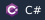

<picture>
  <source media="(prefers-color-scheme: dark)" srcset="https://capsule-render.vercel.app/api?type=waving&amp;color=0%3A111827%2C100%3A283c53&amp;height=128&amp;section=header&amp;text=kyeong205&amp;fontSize=50&amp;fontColor=ffffff&amp;fontAlignY=43&amp;animation=fadeIn" />
  
</picture>

## Tech Stack

  <strong>Languages</strong> 
  
  
  
  
  

  <strong>Frameworks &amp; Platforms</strong> 
  
  
  
  
  
  

  <strong>Databases</strong> 
  
  
  
  

## Farm

  

## Contributions

<picture>
  <source media="(prefers-color-scheme: dark)" srcset="https://raw.githubusercontent.com/kyeong205/kyeong205/output/github-contribution-grid-snake-dark.svg" />
  
</picture>
